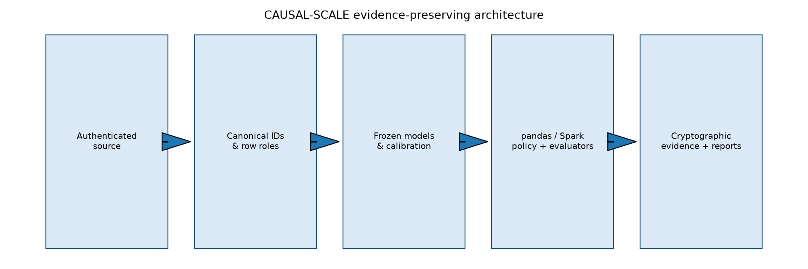
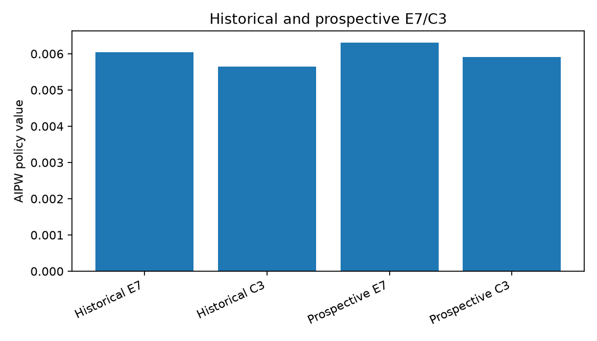
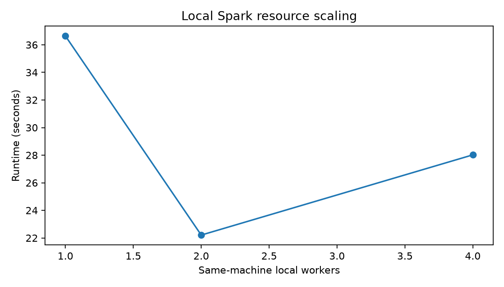

# CAUSAL-SCALE

**Distributed causal machine learning and capacity-constrained policy evaluation, validated by a sealed prospective replication.**

[](https://github.com/ReviveCoding/causal-scale/actions/workflows/ci.yml)
[](https://www.python.org/downloads/)
[](LICENSE)

CAUSAL-SCALE asks a practical question: when intervention capacity is fixed, which people should a policy target to maximize incremental outcome—not merely predicted response? The repository keeps historical, development, retrospective, systems, external, and prospective evidence separate so that systems scale is never presented as causal validation.

## Key results

| Result and comparison baseline | Absolute and relative difference | Uncertainty and support | Evidence class and claim boundary |
|---|---:|---|---|
| **Fresh sealed 2M replication:** E7 `0.0063127390` vs frozen HIST_C3 DR baseline `0.0059089824` at 20% capacity | `+0.0004037566` (**+6.83%** vs C3) | Paired 95% interval `[0.0001217940, 0.0007010708]`; predeclared noninferiority lower bound `0.0001621445 > -0.00025`, so H1 passed | **Prospective.** Supports replication over HIST_C3; does not show E7 beat every comparator. [Evidence](reports/tables/prospective_summary.csv) |
| **Prospective calibration:** E7 RMSE `0.0049530331` vs C3 `0.0088863005` | `-0.0039332673` (**44.26% lower**) | One-sided 95% upper bound `-0.0024691233 < 0`, so predeclared H2 superiority passed | **Prospective.** Supports better calibration than C3 under the declared metric; not universal calibration superiority. [Audit](evidence/prospective/final_audit.json) |
| **Historical Spark parity:** Spark vs frozen reference for E7 and C3 on 2M rows | `0` score error, `0` membership mismatches, `100%` policy agreement; AIPW error about `5e-17` | Exact deterministic parity check; no sampling interval applies | **Distributed parity.** Supports implementation equivalence on this workload, not a new causal result or physical multi-node claim. [Evidence](evidence/spark/historical_parity/metrics.json) |
| **Authentic full-source feature workload:** 13,979,592 rows on `local[4]` | `68.0202 s`, `205,521 rows/s`; no valid speedup baseline was recorded for this row count | One measured run; no uncertainty interval | **Systems-only, scoring-only.** Supports local throughput at authentic row count, not end-to-end speed, holdout evidence, or online lift. [Evidence](evidence/systems/scale/metrics.json) |
| **RTX/XGBoost CUDA qualification:** GPU inference `0.1105 s` vs CPU `0.0766 s` on the same controlled fixture | `0.693x` CPU/GPU speedup, so GPU was **slower** here; peak VRAM `212 MiB` | One controlled run; no uncertainty interval; prediction correlation `0.9031`, policy agreement `91.494%` | **Systems-only.** Supports actual RTX/CUDA execution, not a speed advantage in this run or greater causal validity. [Evidence](evidence/gpu/controlled_benchmark/metrics.json) |

The full interpretation—including every major comparator, uncertainty, capacity sensitivity, scaling efficiency, and failed/omitted work—is in [Results Analysis](reports/RESULTS_ANALYSIS.md).



## Why CAUSAL-SCALE

Response prediction estimates who is likely to respond. Causal targeting estimates whose outcome is likely to change because of treatment. Those rankings need not agree. CAUSAL-SCALE evaluates incremental policy value against never treating while enforcing a fixed treatment capacity, deterministic tie-breaking, and positive-effect eligibility for causal policies. Response models remain important non-causal comparators, and their stronger point estimates in some views are reported rather than hidden.

## Experimental design

The evidence boundary is:

`frozen ORBIT-Causal predecessor` → `development-only fitting` → `retrospective historical evaluation` → `Spark parity and systems qualification` → `scientific freeze` → `feature/policy seal` → `one-shot fresh outcome access`.

The prospective cohort contained 2,000,000 rows disjoint from prior roles. The final audit verified the scientific-contract digest, feature-policy artifact binding, row identity, attempt history, and both predeclared primary gates. See the [final prospective audit](evidence/prospective/final_audit.json) and [completion gates](evidence/final_audit/completion_gates.json).

## Methods

| Method | Role |
|---|---|
| Response marginal / response treated | Non-causal response-ranking comparators |
| Constant ATE | Homogeneous-effect causal baseline with deterministic allocation |
| T-, X-, and R-learners | Heterogeneous-effect learners, with XGBoost CPU/CUDA implementations where qualified |
| HIST_C3 | Frozen doubly robust historical baseline and prospective primary comparator |
| HIST_E7 | Frozen predecessor candidate tested in the prospective replication |
| RCT-IPW/HT and independent AIPW | Sensitivity evaluators alongside the frozen historical AIPW evaluator |
| Causal Forest | Attempted twice with unchanged parameters; omitted after a recorded Windows sandbox multiprocessing blocker |

The primary estimand is AIPW incremental policy value at 20% capacity versus never treating. Inference uses exact pretreatment-profile clustering for E7/C3 and Holm correction within evaluator for secondary comparisons. Criteo has no unit-level counterfactual truth, so CAUSAL-SCALE does not report Criteo PEHE. Full definitions are in [Methods and Estimands](reports/METHODS_AND_ESTIMANDS.md).

## Prospective replication

E7 passed both predeclared co-primary gates relative to HIST_C3: value noninferiority and calibration superiority. Under historical and independent AIPW, both response-targeting policies had slightly higher point estimates than E7, but their direct E7 differences were not statistically significant after Holm correction; under RCT-IPW/HT, E7's point estimates were slightly higher and also non-significant. The supported claim is therefore **prospective replication over HIST_C3 with strong performance against several causal learners**, not superiority over every causal and non-causal comparator.



## Distributed systems

Spark reproduced frozen E7 and C3 scores, policy memberships, and AIPW values on the historical 2M rows with 100% policy agreement. Partition-invariance checks also passed. The authentic 13.98M run accessed features only and measured scoring—not training, full ingestion, causal evaluation, or an independent outcome holdout.

On the identical 1M-row local scaling workload, two workers were empirically best: `22.2093 s`, `1.650x` speedup, and `82.48%` parallel efficiency versus one worker. Four workers regressed to `28.0226 s`, `1.307x`, and `32.68%` efficiency. Event summaries show more tasks at four workers with essentially unchanged shuffle volume and no spill, consistent with local scheduling/coordination overhead. All workers shared one physical machine and one Spark executor; this is not a physical cluster result.



## GPU

The controlled 100K fixture verified XGBoost CUDA execution on an NVIDIA GeForce RTX 4090 Laptop GPU. Recorded GPU training time was `0.4352 s`; the corresponding CPU training time was not retained, so no training speedup is claimed. For inference, CPU was `0.0766 s` and GPU was `0.1105 s`, yielding `0.693x` CPU/GPU speedup. GPU acceleration is an implementation option; it does not change causal identification, estimands, uncertainty, or validity.

## Reproduction

### 1. Public and synthetic CI path

Python 3.11 and Java 17 are required for the complete public CI path. No Criteo download, NVIDIA GPU, local evidence vault, or prospective outcome access is performed.

```bash
python -m venv .venv
# Activate .venv using your shell, then:
python -m pip install ".[dev,spark]"
ruff format --check src tests scripts
ruff check src tests scripts
mypy src
pytest -q -m "not spark" --ignore=tests/test_historical_reference.py --basetemp=.local-runs/pytest-public-unit
pytest -q tests/test_spark_fixture.py --basetemp=.local-runs/pytest-public-spark
python -m build --no-isolation
python scripts/audit_public_release.py --strict
```

The historical artifact identity test is excluded because `.reference/` is intentionally not distributed. The workflow in [CI](.github/workflows/ci.yml) also performs a clean installed-wheel import.

### 2. Full real-data, pre-prospective path

Obtain Criteo Uplift v2.1 from the official provider; the expected identity is 13,979,592 rows, 311,422,618 gzip bytes, SHA-256 `2716e1bf0fd157a93b5bf86924d9088419dfbac2022c6cd90030220634f616dc`, under the provider's applicable CC BY-NC-SA 4.0 terms. Raw data is never distributed here.

```powershell
<python> scripts/fetch_datasets.py --required
<python> scripts/run_everything.py --profile full --resume --stop-before-prospective
```

Place the frozen predecessor checkout at `<repo>/.reference/ORBIT-Causal` when running historical-reference checks. The prospective experiment is complete and must not be rerun as part of publication reproduction.

## Evidence

- [Results Analysis](reports/RESULTS_ANALYSIS.md) — comparison-aware interpretation of every headline.
- [Public Evidence Index](reports/PUBLIC_EVIDENCE_INDEX.md) — what each compact artifact supports and does not support.
- [Technical Report](reports/TECHNICAL_REPORT.md) and [Final Status](reports/FINAL_STATUS.md) — study narrative and completion state.
- [Prospective summary](reports/tables/prospective_summary.csv) and [final audit](evidence/prospective/final_audit.json) — paired comparisons, seals, and gates.
- [Completion gates](evidence/final_audit/completion_gates.json) — final project qualification and recorded omissions.
- [Resume Evidence Ledger](reports/RESUME_EVIDENCE_LEDGER.md) — concise source-to-claim mappings.
- [Detailed tables](reports/tables/) and [figures](reports/figures/) — compact aggregate outputs only.

## Limitations

- Offline policy value is not observed online revenue, production ROI, or deployment impact.
- Response-targeting point estimates exceeded E7 under two prospective AIPW views, without statistically demonstrated superiority; E7 did not beat every comparator.
- The authentic 13.98M run is feature-only, scoring-only systems evidence, not an independent causal holdout or end-to-end benchmark.
- Spark workers and cores shared one Windows machine; no physical multi-node cluster was tested.
- CUDA was exercised, but the controlled inference run was slower than CPU and GPU use does not improve causal validity.
- Causal Forest was blocked by sandbox multiprocessing after two unchanged-parameter attempts. Full IHDP replications were resource-skipped; DragonNet/JAX, Hillstrom, ONNX CUDA, and physical multi-node Spark were optional omissions.

See [Limitations](reports/LIMITATIONS.md) for the durable claim boundary.

## Predecessor

CAUSAL-SCALE is a standalone successor to the frozen ORBIT-Causal v0.3.9 benchmark, not a rename. It preserves predecessor semantics through adapters and immutable historical evidence, then adds independent model baselines, distributed parity, systems scale, GPU qualification, external benchmarking, and a fresh sealed prospective replication.

## License and third-party data

Original CAUSAL-SCALE source code is released under the [MIT License](LICENSE). Third-party datasets, model libraries, and packages retain their own terms; no ownership of those materials is claimed. Criteo data and other raw datasets are not included. See [Third-Party Notices](THIRD_PARTY_NOTICES.md).
